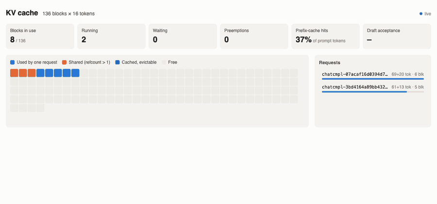
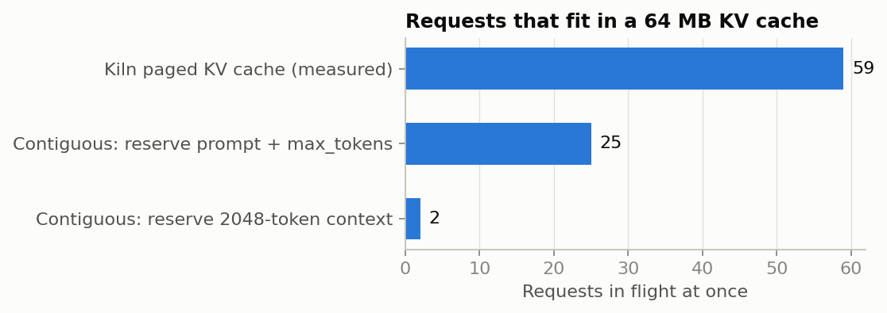
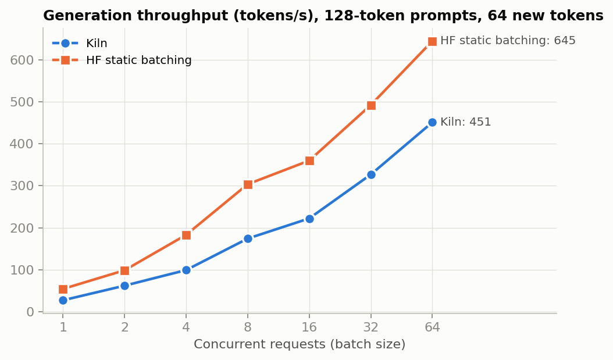

# Kiln

An LLM inference engine built from scratch in Python, PyTorch and Metal. It runs its own Qwen2/Llama transformer with:
- a paged KV cache;
- continuous batching with chunked prefill and preemption;
- prefix caching;
- speculative decoding;
- a hand-written Metal paged-attention kernel.

It's served behind an OpenAI-compatible streaming API, with Prometheus metrics and a live view of the KV cache.

**[Live demo](https://mazennmetwallyy--kiln-demo-web.us-east.modal.run)**: chat with it, or fire a burst of requests and watch them share the KV cache. It runs on 2 free CPU cores and sleeps when idle, so the first load can take about a minute and generation is much slower than the Apple-GPU numbers below. Source: [`demo/`](demo/).



*The live KV-pool view (`kiln serve --enable-viz`, then open `/viz`). 45 chat requests with three different system prompts arrive at 2.5/s into a deliberately small 136-block pool:*
- *blue blocks belong to one request;*
- *orange blocks are shared system-prompt blocks (prefix-cache hits);*
- *green blocks are cached and evictable;*
- *when the pool fills up, the newest requests are preempted and recomputed later.*

## Results

All measured on an Apple M2 with 8 GB, Qwen2.5-0.5B-Instruct in fp16 unless noted, with the committed scripts in `bench/`. Raw results are in `bench/results/`.

| | |
|---|---|
| Serving throughput, 64 ShareGPT requests at once | **569 tok/s**: 4.3× Hugging Face static batching, 10× sequential |
| Time to first token, p50, at 1 request/s | **0.07 s**, against 15.8 s (HF static) and 26.6 s (HF sequential) |
| Requests that fit in a 64 MB KV cache | **59**, against 25 when reserving prompt + max_tokens |
| Prefix caching, 428-token shared system prompt | **−83%** prefill computed, **4.8×** lower mean time to first token |
| Metal decode kernel vs PyTorch gather | attention **1.7–2.8×** faster; serving throughput **1.83×** |
| Correctness | greedy output **token-for-token identical to Hugging Face** (fp32, 12/12 prompts, 2 models), with batching, preemption, prefix caching and speculative decoding |

## Status

| Milestone | |
|---|---|
| M1 Model: own Qwen2/Llama forward pass, sampling, streaming, CLI | ✅ |
| M2 Paged KV cache: block manager, copy-on-write, paged attention | ✅ |
| M3 Continuous batching: iteration-level scheduler, chunked prefill, preemption | ✅ |
| M4 OpenAI-compatible server: SSE streaming, cancellation, Prometheus metrics | ✅ |
| M5 Benchmarks: ShareGPT serving vs Hugging Face, memory, batch scaling | ✅ |
| M6 Prefix caching: SHA-256 hash-chained blocks, LRU eviction of cached blocks | ✅ |
| M7 Speculative decoding: draft model, exact rejection sampling, KV rollback | ✅ |
| M8 Metal paged-attention decode kernel with split-K | ✅ |
| M9 Live KV-cache visualiser | ✅ |

## Serving benchmark

64 real ShareGPT conversations (mean 86 prompt / 140 output tokens). Every system runs behind the same streaming HTTP API and gets the same open-loop Poisson load. The baselines are Hugging Face `transformers` serving one request at a time, and Hugging Face with classic static batching (up to 16 requests padded into one `generate` call). "Kiln" uses the PyTorch attention path; "Kiln + Metal kernel" adds `--attention-backend metal`.


| | Kiln + Metal | Kiln | HF static batching | HF sequential |
|---|---|---|---|---|
| Throughput, all 64 requests at once | **569 tok/s** | 311 tok/s | 131 tok/s | 56 tok/s |
| Time to first token, p50, at 1 request/s | **0.07 s** | 0.08 s | 15.8 s | 26.6 s |
| End-to-end latency, p50, at 2 requests/s | **5.1 s** | 8.1 s | 29.5 s | 46.2 s |
| Inter-token latency, p50, at 2 requests/s | 32 ms | 57 ms | – (no streaming) | **17 ms** |

New requests join the running batch at the next step instead of waiting for a batch, or the previous request, to finish. That's why Kiln's first token comes back in under 0.1 s at realistic arrival rates. Reproduce: `python -m bench.run_serving --data bench/data/sharegpt_64_seed0.json`.



**Memory.** With a 64 MB KV-cache budget, Kiln's paged cache ran 59 of the 64 requests at once (measured). A contiguous cache that reserves prompt + max_tokens per request fits 25, and one that reserves the full 2,048-token context fits 2.



**Where Kiln is still slower.** On one fixed batch with nothing arriving or leaving, Hugging Face's `generate` is faster: 52 against 33 tok/s for one request, and 654 against 558 at 64. Profiling shows this isn't the model. A Kiln forward pass takes 25–27 ms against 32 ms for a direct Hugging Face forward call, and both launch a similar number of GPU operations. The difference is that `generate` never waits for the GPU between steps, so the CPU queues step *n+1* while the GPU runs step *n*. Kiln's scheduler needs each step's tokens on the CPU before it can plan the next step (stop checks, block allocation, admitting new requests), so it waits on every step. Overlapping scheduling with execution, as vLLM's async scheduler does, is the next optimisation.

## Prefix caching

The same 64 questions, each behind one shared 428-token system prompt, all at once:

| | caching off | caching on |
|---|---|---|
| Prompt tokens actually computed | 31,368 | **5,304** (−83%) |
| Time to first token, mean | 10.3 s | **2.2 s** (4.8× faster) |
| Total time for all 64 requests | 52.4 s | **37.2 s** (−29%) |

Outputs are identical with caching on and off: 12 prompts behind a shared system prompt on Qwen2.5-0.5B and SmolLM2, token for token. Keys are SHA-256 over the whole prefix, so a crafted prompt can't collide into another prefix's blocks. Design: [ADR 0004](docs/decisions/0004-prefix-cache-hash-chain.md). Reproduce: `python -m bench.run_prefix --data bench/data/sharegpt_64_seed0.json`.

## Speculative decoding

A small draft model proposes k tokens, the target scores all of them in one forward pass, and modified rejection sampling keeps the target's output distribution exactly. The draft's KV pool shares the target's block tables, so allocation, copy-on-write, preemption, rollback and prefix caching cover both caches at once ([ADR 0005](docs/decisions/0005-draft-shares-block-tables.md)).

- **Exact.** SmolLM2-135M drafting for SmolLM2-360M in fp32: 12/12 prompts identical to the target alone, 59% of draft tokens accepted. Chi-square tests check that sampled outputs follow the target's distribution, including when the draft puts zero probability on tokens the target wants.
- **Speed on this machine.** Qwen2.5-0.5B drafting for Qwen2.5-1.5B, fp16, 12 ShareGPT prompts:

| batch 1 | k = 0 (target alone) | k = 1 | **k = 2** | k = 4 |
|---|---|---|---|---|
| tokens/s | 12.5 | 10.1 | **16.0** (1.28×) | 11.0 |
| draft tokens accepted | – | 76% | 68% | 55% |
| tokens per target forward | 1.00 | 1.74 | 2.32 | 3.09 |

The gain is modest, and it disappears at batch 4, for two measured reasons:
- **The draft isn't cheap enough.** A decode step of the 0.5B draft costs about 0.45× a 1.5B target step (28 vs 63 ms), because at batch 1 both are dominated by per-layer launch overhead rather than FLOPs. The expected speed-up is about (tokens per target forward) / (k × 0.45 + 1), so k = 2 is the sweet spot.
- **Memory.** The two models (4.1 GB of weights) don't both fit in RAM alongside a browser on an 8 GB Mac. Swapping inflated the target's verification pass from 62 ms in isolation to over 200 ms in some runs, and run-to-run variance is large (the k = 0 baseline ranged from 12.5 to 16.6 tok/s).

10 of 12 fp16 outputs are identical to the target alone. The likely cause of the other 2 is fp16 rounding: a 5-token verification pass rounds differently from a 1-token step, which can flip a near-tied token (not yet confirmed). Exactness is tested in fp32, where all 12 are identical. Reproduce: `python -m bench.run_speculative --data bench/data/sharegpt_64_seed0.json`.

## Metal paged-attention kernel

`kiln/attention/metal.py` is a Metal compute kernel, compiled at runtime with `torch.mps.compile_shader`. It reads K/V straight from the paged pool through each sequence's block table, instead of gathering every sequence's history into a padded temporary tensor in every layer on every step.
- **Work split.** One threadgroup per (sequence, head, 256-token partition). `simd_sum` dot products, an online softmax merged across SIMD groups, and a second kernel that merges partitions (FlashDecoding-style split-K).
- **Split-K was needed.** Without it, a single long request filled only 14 threadgroups and the kernel was slower than PyTorch (0.87× at 2,048 tokens).

| one decode step, whole model | PyTorch gather + SDPA | Metal kernel |
|---|---|---|
| batch 1, 2,048-token context | 34.6 ms | **31.6 ms** |
| batch 8, 2,048-token context | 69.0 ms | **49.1 ms** (1.40×) |
| batch 32, 1,024-token context | 129.5 ms | **86.5 ms** (1.50×) |

Under real serving load the gain is larger (311 → 569 tok/s), because the PyTorch path pads every sequence to the longest one in the batch and the kernel doesn't. The kernel is tested against the PyTorch reference in fp16/fp32 with GQA, scattered blocks and partition sizes that force 0, some and many splits. Engine output is identical with either backend. Design: [ADR 0006](docs/decisions/0006-metal-decode-kernel.md). Reproduce: `python -m bench.run_kernel`.

## Quickstart

```bash
python3 -m venv .venv && .venv/bin/pip install -e ".[dev]"
.venv/bin/kiln generate --model Qwen/Qwen2.5-0.5B-Instruct --chat --prompt "Explain a KV cache in one sentence." --device mps --dtype fp16
```

Serve it with an OpenAI-compatible API and call it from any OpenAI client:

```bash
.venv/bin/kiln serve --model Qwen/Qwen2.5-0.5B-Instruct --attention-backend metal --port 8000
```

```python
from openai import OpenAI
client = OpenAI(base_url="http://localhost:8000/v1", api_key="unused")
stream = client.chat.completions.create(model="qwen", messages=[{"role": "user", "content": "Hi!"}], stream=True)
for chunk in stream:
    print(chunk.choices[0].delta.content or "", end="") if chunk.choices else None
```

Endpoints: `/v1/completions`, `/v1/chat/completions` (streaming and non-streaming), `/v1/models`, `/health`, `/metrics`, and with `--enable-viz` also `/viz`, `/kv` and `/kv/stream`.

Useful flags:

| Flag | Effect |
|---|---|
| `--attention-backend metal` | Use the Metal decode kernel. |
| `--draft-model Qwen/Qwen2.5-0.5B-Instruct --num-speculative-tokens 2` | Speculative decoding. |
| `--no-prefix-caching` | Turn prefix caching off. |
| `--kv-memory-gb` | Size of the KV pool. |
| `--enable-viz` | Serve the live view. Trusted users only: it shows every request's blocks. |

Tests: `pytest` (fast, CPU, no downloads). `pytest --runslow --runmps` adds the real-model and GPU checks.

## How it works

[`docs/how-it-works.md`](docs/how-it-works.md) walks through every component and the trade-offs behind it. The design decisions are in [`docs/decisions/`](docs/decisions/).

## Credits

The ideas implemented here come from:
- Kwon et al., *Efficient Memory Management for LLM Serving with PagedAttention* (vLLM, 2023);
- Yu et al., *Orca* (2022);
- Leviathan et al., *Fast Inference from Transformers via Speculative Decoding* (2023);
- Chen et al., *Accelerating Large Language Model Decoding with Speculative Sampling* (2023);
- Dao et al., *FlashAttention* (2022) and *Flash-Decoding* (2023);
- Zheng et al., *SGLang / RadixAttention* (2024);
- Su et al., *RoFormer* (2021).
