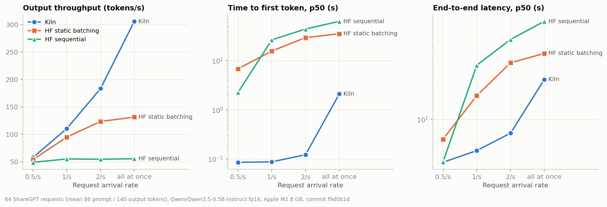

# Kiln

An LLM inference engine built from scratch in Python and PyTorch. It has its own transformer implementation, and the roadmap adds a paged KV cache, continuous batching, prefix caching, speculative decoding and a hand-written Metal attention kernel, served behind an OpenAI-compatible API.

## Status

| Milestone | | |
|---|---|---|
| M1 Model: own Qwen2/Llama forward pass, sampling, streaming, CLI | ✅ | |
| M2 Paged KV cache: block manager, copy-on-write, paged attention | ✅ | |
| M3 Continuous batching: iteration-level scheduler, chunked prefill, preemption | ✅ | |
| M4 OpenAI-compatible server: SSE streaming, cancellation, Prometheus metrics | ✅ | |
| M5 Benchmarks: ShareGPT serving vs Hugging Face, memory, batch scaling | ✅ | |
| M6 Prefix caching · M7 Speculative decoding · M8 Metal kernel · M9 Visualiser | | |

**M1 results** (Apple M2, 8 GB):
- Greedy output is **token-for-token identical to Hugging Face `transformers`** on 12/12 test prompts for both Qwen2.5-0.5B-Instruct and SmolLM2-135M-Instruct (fp32, 64 tokens each). Logits match exactly.
- **Batching doesn't change outputs:** all 12 prompts submitted to the engine at once (ragged prefill + batched decode) are still token-for-token identical to Hugging Face for both models.
- In fp16 on the Mac GPU (MPS), the top-1 token agrees on every prompt (worst logit difference 0.064).
- Single-request decode, Qwen2.5-0.5B, fp16, MPS: 32.0 tokens/s on the paged cache (23.5 in M1, before GPU syncs were removed from the attention layers). That's the unbatched baseline M3 improves on.

## Benchmarks (M5)

64 real ShareGPT conversations (mean 86 prompt / 140 output tokens), Qwen2.5-0.5B-Instruct, fp16, Apple M2 with 8 GB. Each system runs behind the same streaming HTTP API and is hit by the same open-loop Poisson load generator. Baselines: Hugging Face `transformers` serving one request at a time, and Hugging Face with classic static batching (up to 16 requests padded into one `generate` call). Raw results are in `bench/results/`. Reproduce them with `python -m bench.run_serving --data bench/data/sharegpt_64_seed0.json` (see `bench/`).



| | Kiln | HF static batching | HF sequential |
|---|---|---|---|
| Throughput, all 64 requests at once | **306 tok/s** | 131 tok/s | 56 tok/s |
| Time to first token, p50, at 1 request/s | **0.09 s** | 15.8 s | 26.6 s |
| End-to-end latency, p50, at 2 requests/s | **7.7 s** | 29.5 s | 46.2 s |

Kiln's throughput is 2.3× static batching and 5.5× sequential serving. At realistic arrival rates its first token comes back in about 0.1 s, against tens of seconds for both baselines, because new requests join the running batch at the next step instead of waiting for a batch, or the previous request, to finish.


**Memory.** With a 64 MB KV-cache budget, Kiln's paged cache ran 59 of the 64 requests at once (measured). A contiguous cache that reserves prompt + max_tokens per request fits 25, and one that reserves the full 2,048-token context fits 2.


**Where Kiln is still slower.** On one fixed batch with no arrivals or departures, Hugging Face is faster: 54 vs 27 tok/s for a single request, and 645 vs 451 tok/s at 64. HF attends over one contiguous tensor per layer. Kiln's attention is written in plain PyTorch and has to gather each sequence's K/V out of scattered blocks on every step, and that gather grows with context length (profiled: 51 of 93 ms per step at ~700 tokens of context). Kiln wins the serving benchmark on scheduling, not raw step speed. M8 replaces the gather with a hand-written Metal paged-attention kernel.

## Quickstart

```bash
python3 -m venv .venv && .venv/bin/pip install -e ".[dev]"
.venv/bin/kiln generate --model Qwen/Qwen2.5-0.5B-Instruct --chat --prompt "Explain a KV cache in one sentence." --device mps --dtype fp16
```

Serve it with an OpenAI-compatible API and call it from any OpenAI client:

```bash
.venv/bin/kiln serve --model Qwen/Qwen2.5-0.5B-Instruct --port 8000   # Apple GPU, fp16, 1 GB KV pool
```

```python
from openai import OpenAI
client = OpenAI(base_url="http://localhost:8000/v1", api_key="unused")
stream = client.chat.completions.create(model="qwen", messages=[{"role": "user", "content": "Hi!"}], stream=True)
for chunk in stream:
    print(chunk.choices[0].delta.content or "", end="") if chunk.choices else None
```

Endpoints: `/v1/completions`, `/v1/chat/completions` (streaming and non-streaming), `/v1/models`, `/health`, `/metrics`.

Tests: `pytest` (fast, CPU, no downloads). `pytest --runslow --runmps tests/integration -s` runs the real-model checks.

## How it works

See [`docs/how-it-works.md`](docs/how-it-works.md) and the design decisions in [`docs/decisions/`](docs/decisions/).

## Credits

The ideas implemented here come from: Kwon et al., *Efficient Memory Management for LLM Serving with PagedAttention* (vLLM, 2023); Yu et al., *Orca* (2022); Leviathan et al., *Fast Inference from Transformers via Speculative Decoding* (2023); Zheng et al., *SGLang / RadixAttention* (2024); Su et al., *RoFormer* (2021).
